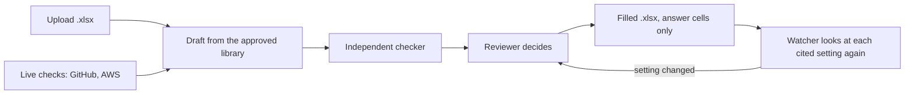

# Standingproof

Answers security questionnaires from approved sources, verifies each answer against live system
settings where it can, and reopens answers already sent when those settings change.

> **Status:** in development. What works today: upload a questionnaire, draft answers from
> your approved library, check them against live settings, review them, get your
> spreadsheet back with the approved answers in it, and have an answer reopened when the
> setting it rests on changes. Not ready for production: there is no
> sign-in yet, and a deployment with `SP_ENVIRONMENT=prod` refuses every request.



## Run it

Requires Docker.

```sh
docker compose up --build --detach --wait
curl localhost:8000/readyz
```

```json
{"status": "ready", "checks": {"postgres": "ok", "redis": "ok"}}
```

## Upload a questionnaire

With the stack running, upload a customer's `.xlsx` file. Each question becomes a row that
records the sheet and cell it came from. The original file is stored unchanged.

```sh
curl -F "file=@questionnaire.xlsx" localhost:8000/questionnaires
curl localhost:8000/questionnaires/QUESTIONNAIRE_ID/questions
```

Columns are found by their headings ("Question", "Requirement", "Response" and similar). When
none is recognised, the response has status `needs_mapping` and a preview of each sheet, and you
choose the columns:

```sh
curl -X PUT localhost:8000/questionnaires/QUESTIONNAIRE_ID/mapping \
  -H "content-type: application/json" \
  -d '{"sheet": "Sheet1", "header_row": 3, "question_column": "B", "answer_column": "D"}'
```

Only plain `.xlsx` files up to 5 MB are accepted; macro-enabled workbooks are refused. Uploading
the same file twice returns the first result. The interactive API reference is at
`localhost:8000/docs`.

## Load your library and search it

The library is what the agent may answer from: answers your company has already approved, and
your policy documents.

```sh
curl -X POST localhost:8000/library/answers -H "content-type: application/json" -d '{
  "question": "Is multi-factor authentication required for employees?",
  "answer": "Yes. Multi-factor authentication is required for all employee accounts.",
  "owner": "security-lead@example.com",
  "expires_on": "2027-06-30",
  "control_id": "CC6.1"
}'
curl -F "file=@access-control-policy.md" localhost:8000/library/policies
curl --get localhost:8000/library/search --data-urlencode "q=Do you enforce 2FA for staff?"
```

Search matches by wording and by meaning, so the question above finds the answer although it
shares no word with it. Each result says how it was found (`keyword`, `meaning`, or an exact
`control_id`) and carries its owner and expiry date. An approved answer past its expiry date is
kept and listed, and is never returned by search. Policies are Markdown or plain text up to
1 MB; they are split by heading, and a result names the heading it came from.

Search returns the closest entries it has. It does not decide that a question has no approved
source: on the project's test set, questions with no source and questions with one had nearest matches
at the same distances. That decision belongs to the answer check, not to retrieval.

### Embedding model

Text is turned into vectors by `BAAI/bge-small-en-v1.5`, which runs inside the process. No
key is needed and no library text leaves the machine. The runtime that executes the model
(ONNX Runtime) ships with usage telemetry switched on; Standingproof switches it off before
the runtime loads, and a test fails if the runtime records anything. Vectors are stored per
model, so you can try another model beside it:

```sh
export SP_EMBEDDING_MODEL=voyage-4-lite VOYAGE_API_KEY=YOUR_VOYAGE_KEY
docker compose up --build -d --wait
docker compose exec api python -m standingproof.library reembed
```

With a Voyage model selected, library text and search queries are sent to Voyage AI. Unset both
variables to return to the local model; its vectors are still there.

Retrieval is measured, not assumed: `uv run pytest -m slow -s tests/eval` runs 33 questions
against a sample library with the real model and prints, for keyword, meaning and combined
search, how often the right source is in the top five.

## Check a live setting

An approved answer says what the policy is. A check looks at what the system does. Standingproof
can read seven settings from GitHub and AWS, store what it saw with the time, and give that to
the agent as a source it can cite.

```sh
curl -X POST localhost:8000/connections -H "content-type: application/json" \
  -d '{"system": "github", "scope": "harborlight"}'
curl -X POST localhost:8000/checks/github.branch_protection/run \
  -H "content-type: application/json" -d '{"scope": "harborlight/app"}'
```

```json
{
  "status": "observed",
  "statement": "Branch main of harborlight/app is protected: a change needs 1 approving review before it can be merged, and the rule does not apply to administrators.",
  "facts": {"default_branch": "main", "protected": true, "required_approving_reviews": 1, "applies_to_administrators": false},
  "observed_at": "2026-11-16T10:02:11Z"
}
```

`GET /checks` lists them: two-factor sign-in for a GitHub organisation, branch protection and
secret scanning for a repository, and for an AWS account root MFA, the password policy, the
account-wide block on public S3 buckets and default disk encryption.

- Read-only, three times over. The credentials you supply should be read-only
  ([SECURITY.md](SECURITY.md) lists the exact permissions). The clients can send only the
  operations on an allow-list in `checks/registry.py`. A test fails if a check uses another.
- Default deny. A check runs only on an organisation or account that is connected, and one
  can be connected only if the operator has listed it in `SP_GITHUB_ORGS` or `SP_AWS_ACCOUNTS`.
  The credentials belong to the deployment, so a caller cannot grant itself a scope, and a
  scope is held by one tenant. Every attempt is stored, including refused ones.
- Nothing is guessed. If the system refuses, is unreachable or does not show the setting,
  the result says "not observed" and why, and offers no fact.
- Only what was needed is kept. A few named fields of the reply are stored, never the
  whole reply.
- An observation is reused for 15 minutes, then looked at again.

To see every check against your own accounts without storing anything:

```sh
uv run python scripts/try_checks.py --github-org harborlight --github-repo harborlight/app \
  --aws-account 123456789012
```

## Run a questionnaire

Answer every question of an uploaded questionnaire in the background:

```sh
curl -X POST localhost:8000/questionnaires/QUESTIONNAIRE_ID/runs      # 202, returns the run
curl localhost:8000/runs/RUN_ID                          # progress
curl "localhost:8000/runs/RUN_ID/questions?status=needs_review"
```

```json
{"status": "finished", "counts": {"ready": 212, "needs_review": 31}, "cost_usd": "1.840000"}
```

Each question ends in one of these states, with the reason and what it cost:

| State | Meaning |
|---|---|
| `ready` | A draft that passed the automatic checks, waiting for a reviewer. `path` says how it was made: `reused` (an approved answer matched the question exactly; no model call) or `drafted` (written by the model from sources it cited) |
| `needs_review` | A person has to look: no approved source, a citation that no tool returned, a limit reached. `reason` says which |
| `failed` | The model provider was unavailable on three attempts |
| `not_started` | The run was cancelled or reached its cost ceiling first |

Nothing here is sent anywhere. A `ready` draft is a proposal for a reviewer.

The work is done by the `worker` service, not by the API. Run more of them to go faster
(`docker compose up --scale worker=3`).

- A restart loses nothing. Each question's progress is saved to Postgres after every step.
  Stop or kill a worker at any moment: another continues each question from its last saved
  step, and a model call that was already paid for is not made again. A test kills a worker
  process mid-run and checks exactly that.
- Spending is bounded. A run stops starting questions once it has spent
  `SP_RUN_COST_LIMIT_USD` (default 5). Questions in progress and attempts that did not finish
  count. A run can end at most one question's own ceiling (`SP_RUN_MAX_COST_USD`) over.
- One run at a time per questionnaire: starting again returns the run in progress.
- A rate limit is waited out, not handed to a person. `POST /runs/RUN_ID/cancel` stops a run.
- Without `ANTHROPIC_API_KEY` the worker still reuses exact approved answers and sends every
  other question to review.

### The independent checker

Every answer the model drafts is read once more by a second model before a person sees it.
The second model is given the question, the draft's wording and the sources the search
returned. It is not given the first model's conversation or notes, and it has no tools.

| The checker's result | Where the question goes |
|---|---|
| Agrees: every claim is in a cited source | `ready` |
| Disagrees: names the words and why | `needs_review`, reason `checker_disagrees`, with the draft kept |
| Could not be run | `needs_review`, reason `not_checked` |

- What it reports: a claim no cited source makes, a source that says otherwise (a live
  check counts for more than a policy sentence), or part of the question left unanswered.
- What it cannot do: make a question `ready`. Plain code decides what its reply means,
  and anything but a clean agreement sends the draft to a person.
- What it is not: proof. It is a second reader from the same provider. "The checker
  agrees" means two readers found nothing, not that the answer is right.
- An approved answer reused word for word is not sent to it.
- Each check is kept (`draft_checks`): the wording it read, its findings, the model, the cost.
- `SP_CHECK_MODEL` (default `claude-sonnet-5-5`) and `SP_CHECK_EFFORT` choose the model;
  `SP_CHECK_ENABLED=false` turns the checker off. Its cost counts against the question and
  the run's ceiling.
- What it costs (measured 2026-11-16, default models): a check is $0.0006 when the
  checker agrees and about $0.0016 with one finding. The instruction and the reply's schema
  (1,155 tokens) are read from the provider's cache; the first check after five idle minutes
  writes that cache and costs $0.003 more. A drafted question costs $0.010 to $0.017 before
  its check, once the drafter's cache is warm. Writing that cache costs $0.010, so when a run
  starts one question goes first and the others wait for it (up to 15 seconds) and then
  read the cache. Measured on five questions: $0.067 for the run, against $0.095 when all
  four drafted questions wrote the cache; the run took 27 seconds, against 14.

## Review a run

When a question has been drafted, or handed over with a reason, it waits for a person. Nothing
is approved by the software.

```sh
curl localhost:8000/run-questions/QUESTION_ID            # the draft, with the text of each source
curl -X POST localhost:8000/run-questions/QUESTION_ID/decision -H "content-type: application/json" \
  -d '{"decision": "approve", "version": 1}'
```

| Decision | What it records |
|---|---|
| `approve` | The draft's exact wording becomes the final answer |
| `edit` | Your wording (`answer`) becomes the final answer; the draft is kept beside it. A term such as "certified" that no cited source uses comes back as a warning |
| `reject` | No final answer, with your `comment` |
| `redraft` | Your `comment` goes to the agent as an instruction, and a new draft comes back for review. At most twice per question |

- Every decision is a record: who, when, what they were shown and what they approved.
  Records are only ever added.
- `version` is the question's version when you read it. If someone else decided first, or a
  redraft arrived, your decision is refused with `409` and nothing changes.
- `POST /runs/RUN_ID/approve-ready` with `{"count": n}` approves every draft that passed all
  automatic checks. `n` must be the number you were shown. Each is recorded as approved in a
  batch.
- Live updates: `WS /runs/RUN_ID/events` sends `{"type": "changed"}` whenever the run
  changes. It carries no data; ask the API for the new state.
- A question nobody decides within `SP_REVIEW_KEEP_DAYS` (default 30) is closed as `expired`.

### In the browser

`docker compose up --build` also starts the reviewer's screen at http://localhost:3000. Open a
run to see every question with its proposed answer beside the text of its sources.

- What needs a person is listed first, with the reason in words.
- When the checker disputes a draft, the disputed words are marked in the answer and each
  finding is listed under it with its reason.
- The drafting model's own note about its draft is shown under its own heading, apart from
  the checker's result. The checker never saw it.
- One key per decision: `A` approve, `E` edit, `R` reject, `D` ask for a redraft; `J` and `K`
  move between questions. The keys are off while you type.
- The page updates as the run progresses. If the live connection is lost it says so and asks
  every 5 seconds instead.
- When every question has a decision, **Filled file** in the header opens a page that
  lists each cell that will be written and each one left empty with the reason, and
  downloads your spreadsheet with the answers in it.
- It works with the keyboard alone, in light and dark, and on a phone.

The screen is a Next.js app in [`web/`](web). The browser talks only to it; it forwards to the
API, whose address the browser never sees. Develop it with `cd web && pnpm install && pnpm dev`.

Until sign-in exists, every decision is recorded under the name in `SP_DEV_REVIEWER`, and a
deployment with `SP_ENVIRONMENT=prod` refuses every request.

## Get the filled file back

When every question of a run has a decision, the approved answers can be written into the
spreadsheet that was uploaded.

```sh
curl localhost:8000/runs/RUN_ID/file/preview            # what would change
curl -X POST localhost:8000/runs/RUN_ID/file            # make it: 201, or 200 if it exists
curl -OJ localhost:8000/runs/RUN_ID/file/FILE_ID      # download
```

- Only the answer cells change. Every file inside the workbook is copied as it is, and
  in a sheet only the bytes of the written cells are replaced or added. After writing, the
  result is compared with the upload; a result that differs anywhere else is not stored and
  the request answers 422.
- Made once. The same decisions always give the same file. Asking again, at the same
  moment or after a failure, returns the first one. A changed decision gives a new file and
  the earlier one is kept.
- Not made early. 409 while any question is undecided, or if a question's approved
  wording is not the wording its decision recorded.
- A dropdown with a comments column beside it (headings such as Comments, Notes,
  Explanation): the approved wording goes into the comments cell. The dropdown gets its
  value only when the wording begins with exactly one of the dropdown's own values followed
  by punctuation or the end ("Yes. Keys are rotated." gives Yes); otherwise it is left for
  you to choose. The preview shows both cells before you download.
- Left empty, and listed with the reason: a rejected, expired or unanswered question; a
  question with no answer column; a cell that already has content; a dropdown cell with no
  comments column, unless the approved wording is exactly one of its values; wording longer
  than a cell holds (32,767 characters) or with characters a workbook cannot carry.
- A merged answer cell gets the wording in the range's first cell.
- Answers are written as text. Wording that begins with `=` stays text and is never a
  formula.

After you have sent the file, record it:

```sh
curl -X POST localhost:8000/runs/RUN_ID/file/FILE_ID/sent \
  -H 'content-type: application/json' -d '{"customer": "Acme Corp"}'
```

This records that a reviewer said the file was sent, to whom and when, with a hash of each
answer's wording as it went out. It sends nothing and does not say the file was delivered.
It is append-only, and recording the same file for the same customer twice is one record.

Limits: `.xlsx` only. The tests read every result back with a spreadsheet library and
compare it with the upload; no test opens the result in Excel. The sample results were
opened once by hand in LibreOffice 25.2. A dropdown whose values are in other cells, not
typed into the rule, cannot be read and is left empty.

## When a setting changes afterwards

An answer that cites a live check rests on what that check saw. The `watcher` service looks
at each such setting again, and when it reads differently the answer goes back to a
reviewer: the question shows the value it was approved against, the value now, and the
customers a file with that wording was recorded as sent to.

```sh
curl localhost:8000/changes               # each change, with the answers it reopened
curl localhost:8000/checks/watched        # the settings answers rest on, and the last look
```

- When it looks. Every setting an answer rests on, once a day
  (`SP_RECHECK_SECONDS`), and an hour after a look that could not reach the system. For
  GitHub, also within seconds of a webhook delivery.
- What reopening does. The question waits for a decision again and no file can be made
  until it has one. Its approved wording, the files already made and the sent records are
  not changed. A reviewer keeps the answer, edits it, withdraws it, or sends it back to the
  agent. `approve` is refused on a reopened question: use `keep`.
- What counts. The named facts of the check differ. A look that failed says nothing
  and reopens nothing. Answers that are approved (sent or not) and drafts still waiting are
  covered; rejected and unanswered questions are not.

To have GitHub tell the product at once, add a webhook to the organisation or repository:
payload URL `https://YOUR_HOST/webhooks/github`, content type `application/json`, a
secret, and the events `branch_protection_rule` and `security_and_analysis`. Put the same
secret in `SP_GITHUB_WEBHOOK_SECRET`.

- A delivery is believed for one thing: that its sender holds the secret
  (`X-Hub-Signature-256`, HMAC-SHA256 over the body, compared in constant time). What it
  says is only where to look. The watcher then reads the setting itself with the read-only
  credential, and only that reading is ever shown as a fact.
- A delivery that arrives twice is recorded once. Several for one setting are answered by
  one look, and a setting is looked at for webhooks at most once in
  `SP_WEBHOOK_MIN_GAP_SECONDS` (30).
- With no secret configured the route answers 404. The payload is not stored: only the
  delivery id, the event, its action and the repository name, and those are deleted
  `SP_WEBHOOK_KEEP_DAYS` (30) after the delivery was dealt with.
- A delivery about a setting no answer rests on is recorded and not looked at.
- Expose only this one route. Every other route acts without sign-in in this version,
  and the stack binds its ports to 127.0.0.1 for that reason. To receive deliveries, put a
  reverse proxy in front that forwards `POST /webhooks/github` and nothing else.

Limits: an answer is linked to a setting only through the check it cites; an answer whose
wording depends on a setting it never cited is not noticed. Organisation two-factor and all
AWS settings have no webhook and rely on the daily look. Branch protection set through
rulesets is not read. Changes to policy documents and library answers do not reopen
anything yet. Nobody is notified outside the product: the runs list and the Changes page
show it. Nothing alerts when the watcher itself is stopped.

## Limits and the audit log

Four controls sit in code, not in a prompt. Each is described in [SECURITY.md](SECURITY.md).

| Control | What it does | Command |
|---|---|---|
| Tenant isolation | Postgres shows a session one tenant's rows, whatever the query says | none: it is always on |
| Daily spend ceiling | Over it, no model call is made and the question goes to a reviewer | `python -m standingproof.limits show` |
| Stop switch | No model call and no live check starts until an operator resumes | `python -m standingproof.limits stop --by YOUR_NAME` |
| Audit log | Every decision, hash-chained and append-only | `python -m standingproof.audit verify` |

## When something fails

| Symptom | Cause | Resolution |
|---|---|---|
| `/readyz` answers 503 | Postgres or Redis is not reachable; the body names which | Wait for `docker compose up --wait` to finish, or read `docker compose logs postgres redis` |
| Every request answers 401 | `SP_ENVIRONMENT=prod`. There is no sign-in yet, so production refuses everything | Run without it until sign-in exists |
| An upload answers 413, 415 or 422 | The file is over 5 MB, is not a plain `.xlsx` (macro-enabled workbooks are refused), or cannot be parsed | Save the workbook as `.xlsx` without macros and upload it again |
| An upload answers with status `needs_mapping` | No column heading was recognised | Send the columns with `PUT /questionnaires/QUESTIONNAIRE_ID/mapping` |
| A check answers `not_configured` or `unavailable` | No credential is set, or the system refused, timed out or hid the setting. The `reason` says which | Set the credential or its permission ([SECURITY.md](SECURITY.md)) and run the check again |
| A decision answers 409 | Someone else decided first, or a redraft arrived, so your `version` is old | Read the question again and decide on the new version |
| `POST /runs/RUN_ID/file` answers 409 | A question is undecided, or was reopened by a changed setting | Decide it (`keep` for a reopened one), then ask again |
| A question needs review with "today's spend ceiling was reached" | The tenant or the deployment has spent its daily ceiling | Wait for the next day (UTC), or raise it: `python -m standingproof.limits daily --by YOUR_NAME --usd 20` ([SECURITY.md](SECURITY.md)) |
| Questions stay queued and nothing is drafted | The stop switch is on | `python -m standingproof.limits show`, then `resume --by YOUR_NAME` |
| `POST /webhooks/github` answers 404 | `SP_GITHUB_WEBHOOK_SECRET` is not set | Set it to the secret you gave GitHub and restart |

## How it is measured

Tests prove the code around the model. They say nothing about how often the model's answers
are right, so that is measured separately, on two sets of cases kept in [`evals/`](evals/).

**The drafter set** is 32 questions, each with a made-up company: a library of approved
answers, and what a GitHub and an AWS that exist only in the eval read. The right answer
follows from that world. The real drafter and the real checker run on each case three
times, and code grades every run:

- right: marked ready, and the wording states what the world supports;
- safe: it went to a person (a handoff, an objection from the checker, or "no approved
  source" where one existed);
- wrong: marked ready, and the wording is not supported. This is the failure a customer
  would see with nobody having looked.

**The checker set** is 52 hand-written drafts: 17 sound, 35 with one planted defect (a wider
scope than the source, a stronger word, an added detail, a wrong number, a contradiction
with an observed setting, half an answer, a planted instruction).

Two full runs so far. The first, on 2026-11-16, was left as it came out. It showed three
faults, which were then fixed, and the second run on 2026-11-17 measured the fixes. The
second run is therefore not a first look: the prompts were changed after reading the first.

| | First run | Second run |
|---|---|---|
| Drafter cases ready and wrong in any of 3 runs | 0 of 32 | 0 of 32 |
| Drafter cases right in most of 3 runs | 21 of 32 | 29 of 32 |
| Planted defects the checker agreed with in any run | 0 of 32 | 0 of 35 |
| Sound drafts the checker objected to in most runs | 1 of 16 | 0 of 17 |

Ten of the cases have an approved library answer that the live setting contradicts. With
the live check, no run of those was ready and wrong in either run: in the second, 21 runs
were right and 9 went to a person. With the check tool taken away, the same ten were ready
and wrong 10 times out of 10, both times: the agent repeated the library, and the checker,
shown only the library, agreed.

What the first run showed, and what was done:

- When the library and the live setting disagreed, the drafter stated the setting and
  cited it, and the checker still objected in 21 of 30 runs, pointing at the stale library
  answer. The checker is now told, by a mark set in code, which source is an observation,
  and that a document set aside for an observation of the same setting does not contradict
  the draft.
- When a look was rate limited the drafter tried the same look again, and the loop's
  repeated-call rule stopped the run. A look that observes nothing now says not to repeat
  it; all three runs of that case now end as "no approved source".
- The checker objected to a draft that says "we have no approved statement about" the part
  it cannot answer. This was left alone on purpose: such a draft should reach a person.
  The objection did not recur in the second run, which is chance, not a fix.

What the second run shows that is not good:

- 3 of 32 cases are not right by majority; every run of those went to a person. In two,
  the drafter adds a detail the observation's sentence does not give ("0 approving
  reviews" for an unprotected branch), and the checker objects. In the third, the question
  asks about contractors and the library covers employees.
- One case had to be corrected after the run: its pattern rejected a true answer.

These are small sets written by the author of the system, about one company. 29 of 32 has
a 95% interval of 76% to 97%; 35 of 35 defects caught has one of 90% to 100%. The full
tables, every miss by name and the comparison with a cheaper check model are in
[`evals/REPORT.md`](evals/REPORT.md).

The eval calls the paid API, so it does not run in CI. Its replies are recorded in
`evals/recordings/`, and CI grades those recordings again with the current rules on every
pull request (`uv run python -m evals score`). It fails if a case is newly ready and wrong,
if a planted defect is newly agreed with, or if a prompt, a tool description, an output
schema, a model or a case has changed since the recordings were made. In that last case the
eval has to be run again:

```sh
uv run python -m evals estimate     # what it would cost; calls nothing
uv run python -m evals run          # asks first, and stops at a spending ceiling
uv run python -m evals report
uv run python -m evals accept --note "why the baseline changed"
```

A full run cost $2.15. It reads no real GitHub or AWS, and takes nothing from the shell but
the model key.

## Try the agent on one question

Needs an Anthropic API key in `.env` (see `.env.example`). Each run costs a few cents.

```sh
uv run python -m standingproof.agent "Is multi-factor authentication enforced for all employees?"
```

The agent searches a small sample library of approved answers, replies only from what it finds,
and reports "no approved source" when nothing supports an answer. A draft is then read by the
independent checker, and its result is printed.

## Develop

Requires [uv](https://docs.astral.sh/uv/) and Docker.

```sh
uv sync
uv run pytest -v
```

See [CONTRIBUTING.md](CONTRIBUTING.md). To report a vulnerability, see [SECURITY.md](SECURITY.md).

## Licence

[Apache-2.0](LICENSE)
