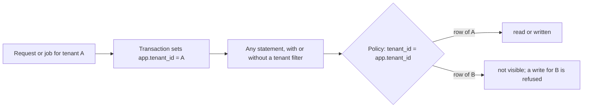

# Security policy

## Reporting a vulnerability

Please report vulnerabilities privately through the "Report a vulnerability" button on the
Security tab of this repository. Do not open a public issue.

You will get an acknowledgement within 5 working days. Please include steps to reproduce and the
version or commit affected.

## Supported versions

The project is pre-1.0. Only the latest commit on `main` is supported.

## Credentials the product uses

Standingproof never needs write access to your systems. Give it credentials that cannot write.

| Credential | Used for | Permissions it needs |
|---|---|---|
| `ANTHROPIC_API_KEY` | Drafting answers | An API key |
| `SP_GITHUB_TOKEN` | Live checks of GitHub settings | A fine-grained token: repository **Administration: read** and **Metadata: read**; organisation **Administration: read** |
| AWS credentials (the SDK's standard variables, or a role) | Live checks of AWS settings | `iam:GetAccountSummary`, `iam:GetAccountPasswordPolicy`, `s3:GetAccountPublicAccessBlock`, `ec2:GetEbsEncryptionByDefault` |
| `VOYAGE_API_KEY` (optional) | A hosted embedding model, if you choose one | An API key |

AWS policy for the checks:

```json
{
  "Version": "2012-10-17",
  "Statement": [
    {
      "Effect": "Allow",
      "Action": [
        "iam:GetAccountSummary",
        "iam:GetAccountPasswordPolicy",
        "s3:GetAccountPublicAccessBlock",
        "ec2:GetEbsEncryptionByDefault"
      ],
      "Resource": "*"
    }
  ]
}
```

In this version credentials are read from the environment, one set for the whole deployment.
Because they are shared, which organisations and accounts they may be used on is set by the
operator (`SP_GITHUB_ORGS`, `SP_AWS_ACCOUNTS`), not by a caller, and each such scope can be
connected by one tenant only. Do not run several tenants that should not see each other's
settings against one set of credentials; per-tenant credentials are planned.
They are not stored in the database, and they are not written to logs, error messages or
stored evidence.

## Tenant isolation

Postgres keeps one tenant's rows from another, not the application's queries. Every table that
holds customer data has a row-level security policy, enabled and forced. A query with no
tenant filter still returns one tenant's rows, and a session that names no tenant gets none.



The services sign in as roles that own nothing. Only the `migrate` service has the owner's URL.

| Role | Used by | What it can do |
|---|---|---|
| owner (`SP_DATABASE_URL`) | `migrate`: migrations, `workflow setup`, `roles` | Everything. No running service has it |
| `standingproof_app` (`SP_APP_DATABASE_URL`) | API, worker, watcher, for one tenant at a time | Read and write customer tables, one tenant's rows per transaction |
| `standingproof_system` (`SP_SYSTEM_DATABASE_URL`) | Finding work: which question is due, which setting to look at, which tenant a webhook is for | Read where and when across tenants (ids, statuses, queue and lease times), and move a question's next queueing time. No right on the library, uploaded or filled files, questions, decisions, a drafted or approved answer, or what an observation saw |
| `standingproof_state` (`SP_STATE_DATABASE_URL`) | The worker's saved workflow state | Schema `workflow` only |

A process refuses a database connection whose role is a superuser, owns a table, or is exempt
from row-level security. Setting every URL to the owner's login therefore fails at the first
query; it does not run without the rules.

To set or change the three passwords, run this as the owner after the migrations. Each password
is the one in that role's URL:

```sh
python -m standingproof.roles
```

> **Warning:** Back up as a superuser or a role with `BYPASSRLS`. The policies are forced, so
> `pg_dump` as a plain owner stops with an error instead of writing a dump with rows missing.

Limits you should know:

- The rules guard against a query that forgets its tenant filter. They do not guard against
  injected SQL: a statement that runs as the app role can name another tenant itself. No
  value from a request reaches that setting, and queries are parameterised.

- There is no sign-in yet, so a deployment has one tenant in practice. The rules above are what
  make a second one safe to add.
- The system role reads scheduling data of every tenant, can close a running run that has no
  open question, can delay any question's queueing, and can create a tenant. It can affect
  availability; it cannot read or change an answer. A test (`tests/attacks/test_cross_tenant_modules.py`) lists the modules
  allowed to use it.
- Saved workflow state is separated from customer tables by role, and one question's state from
  another's by its id. It has no row-level policy: the tables belong to the workflow library.
- The evals (`python -m evals run`) start their own throwaway database and use it as its owner.

## Audit log

Every decision is written to an append-only log in the same transaction as the decision, so
neither exists without the other. Each entry carries a hash of itself and of the entry before
it. Changing, removing or reordering one entry breaks every hash after it.

Recorded: a review decision (with a hash of the approved wording, never the wording), a
connection added, a library answer or policy added, a run started or cancelled, a file made, a
file recorded as sent (by the id of its record, not the customer's name), an answer reopened by a changed
setting, and every change to the stop switch or a spend ceiling. Each tenant has its own
chain; operator actions go in the deployment's. No customer text is kept in the log.

To check every chain, run:

```sh
docker compose exec api python -m standingproof.audit verify
```

```text
deployment: 4 entries, chain intact
tenant default: 412 entries, chain intact
```

A broken chain names the first bad entry on standard error, and the command exits 1.

The database enforces three things itself, whoever is writing:

- An entry cannot be changed or deleted. The running services have no right to, and a trigger
  refuses an `UPDATE` or `DELETE` from the owner too.
- A new entry must be the next number of its chain, link to the last entry's hash, and carry
  a time within a minute of the database's clock. So no entry can be backdated, skipped ahead
  or forked.
- A tenant can write and lock only its own chain.

To also stop an entry being forged by someone who can run SQL as the application, set
`SP_AUDIT_KEY` (32 characters or more, from your secret store). Entries are then signed with
a key the database never sees, and a forged one fails `verify`. Set it before the first entry
and keep it: entries written under one key do not verify under another.

What a sound chain does not prove:

- Without `SP_AUDIT_KEY`, who wrote an entry. The chain then shows that entries were not
  altered or removed, and SQL run as the application could add a false one.
- Who a person is. Until sign-in exists, every request is recorded under `SP_DEV_REVIEWER`.
- That the owner of the database did not rebuild a whole chain, cut one short, or empty it
  with `TRUNCATE` (the trigger covers rows, not `TRUNCATE`). An emptied chain verifies as "0
  entries". To cover this, keep the output of `python -m standingproof.audit head` somewhere
  the database's owner cannot reach. An earlier head must still be an entry of the later
  chain.

A tenant that has audit entries cannot be deleted: the log would have to go with it, and the
log does not allow deletion. Removing a tenant is a deliberate act by the database's owner.

## Spend ceiling and stop switch

Before every model call the worker checks two things, in code:

| Check | Where it lives | When it refuses |
|---|---|---|
| Stop switch | A row in Postgres, per tenant and for the deployment | The call is not made. A question in progress goes to a reviewer with the reason; a question not yet started waits and goes on after `resume`. No live check runs either |
| Daily ceiling (UTC) | A counter in Redis, per tenant and for the deployment | The call is not made and the question goes to a reviewer with the reason |

The defaults are `SP_DAILY_LIMIT_USD=20` for the deployment and `SP_TENANT_DAILY_LIMIT_USD=10`
for each tenant. An operator changes them, and the switch, with:

```sh
docker compose exec api python -m standingproof.limits show
docker compose exec api python -m standingproof.limits stop --by YOUR_NAME
docker compose exec api python -m standingproof.limits resume --by YOUR_NAME
docker compose exec api python -m standingproof.limits daily --by YOUR_NAME --usd 5 --tenant default
```

A tenant cannot change its own switch or ceiling: the application's role may only read them.

Limits you should know:

- A call is counted as `SP_CALL_RESERVE_USD` (40 cents: the most one call can cost with the
  default models) until it returns, then as what it cost. A call that fails or is cancelled
  stays counted in full, because what the provider charged for it is not known. If you choose
  a dearer model or a longer reply, raise the reservation to match, or one call can take the
  day over the ceiling.
- The other side of counting failed calls in full: a provider outage uses up the day's ceiling
  at 40 cents a failed call, although a refused call costs nothing. Questions then go to a
  reviewer until the next day or until an operator raises the ceiling.
- If Redis cannot be reached, no model call is made. If Redis loses its data during the day,
  the day's count starts again from zero.
- The ceiling covers the worker's model calls. `python -m evals run` and
  `python -m standingproof.agent` have their own ceilings and are not counted here.
- `--by` is a name you type. Until sign-in exists it is not proof of who ran the command.
- While the switch is on, a webhook delivery waits and is read after `resume`. A question whose
  draft was ready when the ceiling or the switch stopped its checker goes to a reviewer as
  "not checked", not with the ceiling as its reason.
- The counter uses two Redis keys in one script, so it needs a single Redis, not a cluster.

## Where the model key lives

Only the `worker` service is given `ANTHROPIC_API_KEY`. The API service faces the network and
never calls the model, so it does not hold the key.

## Saved workflow state

While a questionnaire is being answered, each question's progress is saved in Postgres (schema
`workflow`): the question text, the sources the tools returned and the model's turns. It is
customer data, kept so that a restart loses nothing.

- It is deleted `SP_STATE_KEEP_DAYS` (default 7) after the question finishes. The result itself
  stays on the run.
- A job on the Redis queue is an id and nothing else. No question or answer text goes through
  Redis.
- The workflow library can send traces of every step to a hosted service (LangSmith). That is
  off unless switched on, and the image sets `LANGSMITH_TRACING=false` so that it stays off.

## Review decisions

- A decision is recorded under the name in `SP_DEV_REVIEWER`. That is a stand-in, not
  authentication: anyone who can reach the API can decide. Do not expose this version to a
  network you do not control. With `SP_ENVIRONMENT=prod` every request is refused.
- A reviewer's instruction for a redraft reaches the model in the system message. Text from a
  questionnaire or a tool result never goes there, so a questionnaire cannot pose as the
  reviewer, and a question cannot close the tags it is wrapped in.
- A browser page may open the live connection (`WS /runs/<id>/events`) only from an origin
  listed in `SP_ALLOWED_ORIGINS`. A WebSocket is not protected by CORS; this list is the
  control. The connection carries the word "changed" and nothing else.

## What leaves your machine

| Destination | What is sent | When |
|---|---|---|
| Anthropic | The question and the sources the agent retrieved | When the agent drafts an answer |
| GitHub, AWS | Read requests for the settings listed above | When a check runs |
| Voyage AI | Library text and search queries | Only if you select a Voyage embedding model |

Nothing else. The local embedding model's runtime ships with usage telemetry enabled by its
vendor; Standingproof disables it, and a test fails if the runtime records anything.
